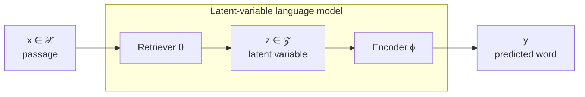
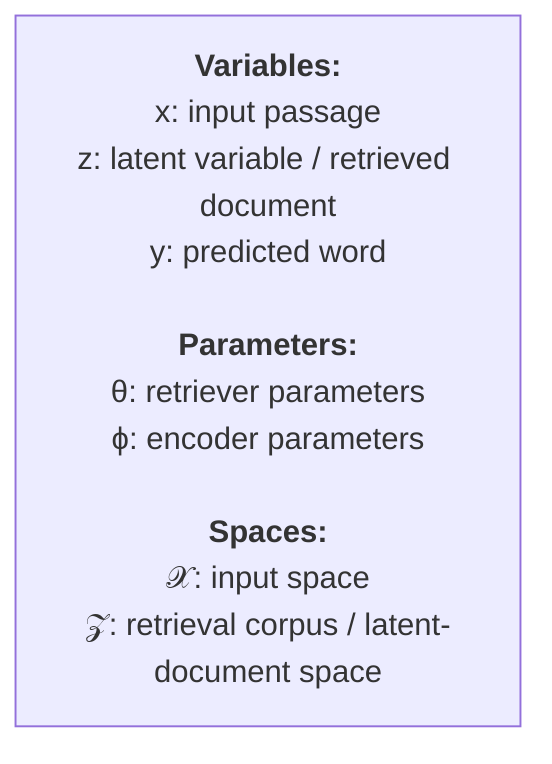

```bibtex
@InProceedings{pmlr-v119-guu20a,
  title = 	 {Retrieval Augmented Language Model Pre-Training},
  author =       {Guu, Kelvin and Lee, Kenton and Tung, Zora and Pasupat, Panupong and Chang, Mingwei},
  booktitle = 	 {Proceedings of the 37th International Conference on Machine Learning},
  pages = 	 {3929--3938},
  year = 	 {2020},
  editor = 	 {III, Hal Daumé and Singh, Aarti},
  volume = 	 {119},
  series = 	 {Proceedings of Machine Learning Research},
  month = 	 {13--18 Jul},
  publisher =    {PMLR},
  pdf = 	 {http://proceedings.mlr.press/v119/guu20a/guu20a.pdf},
  url = 	 {https://proceedings.mlr.press/v119/guu20a.html},
  abstract = 	 {Language model pre-training has been shown to capture a surprising amount of world knowledge, crucial for NLP tasks such as question answering. However, this knowledge is stored implicitly in the parameters of a neural network, requiring ever-larger networks to cover more facts. To capture knowledge in a more modular and interpretable way, we augment language model pre-training with a latent knowledge retriever, which allows the model to retrieve and attend over documents from a large corpus such as Wikipedia, used during pre-training, fine-tuning and inference. For the first time, we show how to pre-train such a knowledge retriever in an unsupervised manner, using masked language modeling as the learning signal and backpropagating through a retrieval step that considers millions of documents. We demonstrate the effectiveness of Retrieval-Augmented Language Model pre-training (REALM) by fine-tuning on the challenging task of Open-domain Question Answering (Open-QA). We compare against state-of-the-art models for both explicit and implicit knowledge storage on three popular Open-QA benchmarks, and find that we outperform all previous methods by a significant margin (4-16% absolute accuracy), while also providing qualitative benefits such as interpretability and modularity.}
}
```

## REALM: Retrieval-Augmented Language Model Pre-Training
- they discuss implicit knowledge
- they use a knowledge retriever
- the knowledge retriever training is a challenge. They use masked language modeling
- they finetuned REALM in Open-QA tasks

why do we need retrieve:
- knowledge in parameters makes difficult to determine where knowledge is stored in the network: hard to audit
- more knowledge in parameters will be inneficient, slow and expensive

proposal
- Retrieval-Augmented Language Model (REALM) pre-training
  - end-to-end architecture: retriver and encoder in the same model, retrived document is latent variable
  - key intuition: performance-based
  - 

**Architecture:**



**Notation:**


